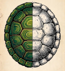
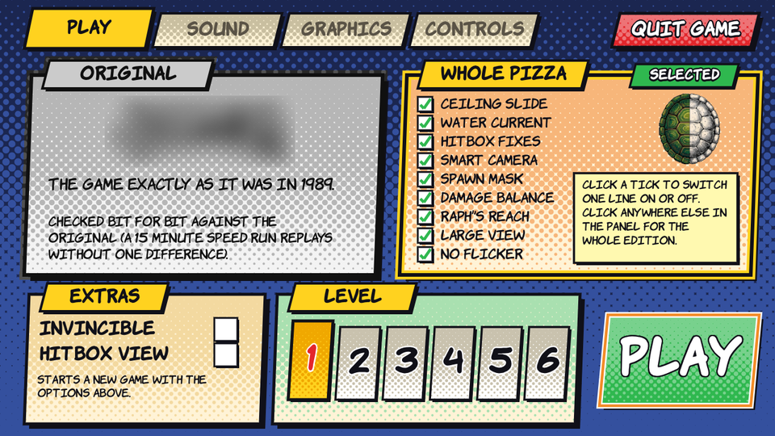
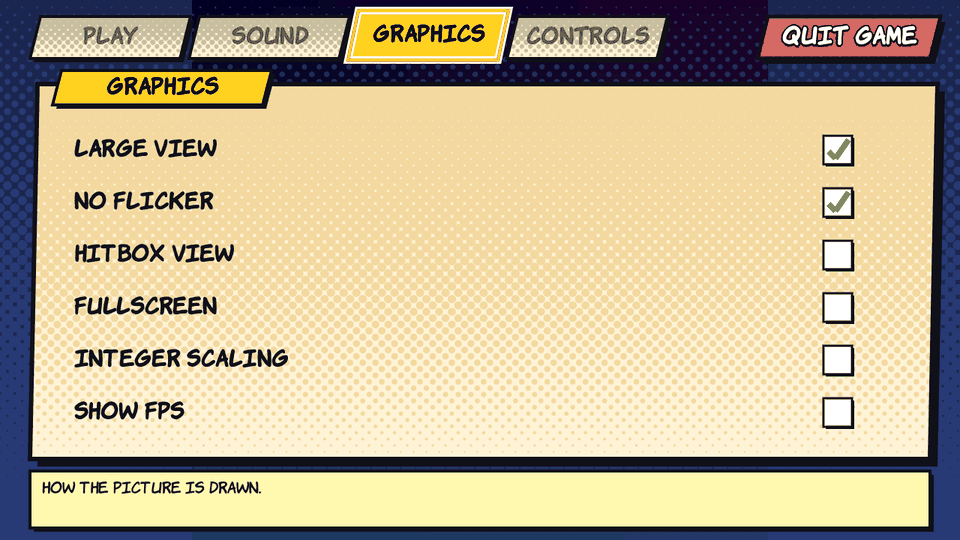
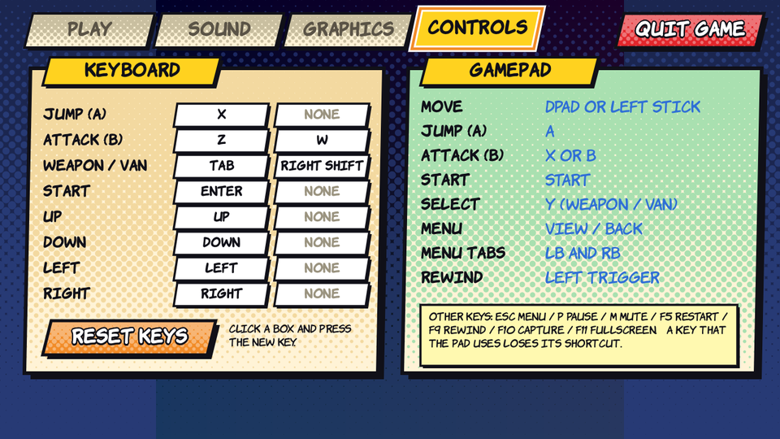

<h1>tmnt-recomp</h1>

A C port of the NES game **Teenage Mutant Ninja Turtles** (Konami, 1989), written function by function from the original 6502 code.

 

**What you get**
- The original game, **exactly** as it was (checked frame by frame against emulators, including a 15 minute speed run).
- An in-game **menu** to choose your options and your level.
- An optional **Whole Pizza** edition: the original game plus a set of fixes and improvements (listed below).
- Display options: fullscreen, integer scaling, FPS counter, and a CRT filter.

It is not an emulator: the game logic is real C, only the NES hardware (picture, sound) is emulated.

> **Note on how this was made.** I was heavily helped by Claude (an AI assistant from Anthropic) for the decompilation part: it analyzed the game and
> wrote the specifications that made a reimplementation possible afterwards. I then did a manual pass to reorganize the whole thing a bit. So this is not
> 100% human-made code.

**The ROM is not included.** You need your own copy of the game, the European (PAL) or the American (USA) release, as a `.nes` file.

## How to play

1. Download the archive of the latest release (the **Releases** page): `tmnt-<version>-windows-x64.zip` or `tmnt-<version>-linux-x86_64.tar.gz`
   (Linux needs SDL2: `sudo apt-get install libsdl2-2.0-0`).
2. Unpack it, and put your ROM (any file name) in the `rom` folder next to the game.
3. Start `tmnt` (`tmnt.exe` on Windows). If the ROM is missing, the game tells you where to put it.
4. In the menu, choose an edition and a level, then click **PLAY**.

## Controls

| | Keyboard | Game pad |
|---|---|---|
| Move | Arrows | D-pad or left stick |
| Jump (A) | X | A |
| Attack (B) | Z or W | X or B |
| Start | Enter | Start |
| Select (change weapon, leave the van) | Tab or right Shift | Y |
| Menu | Esc | View / Back |
| Other keys | P pause, M mute, F11 fullscreen, F5 restart, F9 rewind | Left trigger: rewind |

You can change the keyboard keys in the menu (CONTROLS page).

## The menu

Press **Esc** to open it (it also opens when the game starts). It works with the mouse, the keyboard and a game pad.

| Page | What it does |
|---|---|
| **PLAY** | Choose the edition (Original or Whole Pizza), the extras (invincible, hitbox view) and the level, then play or resume. |
| **SOUND** | Volume and mute. |
| **GRAPHICS** | Large view, no flicker, hitbox view, fullscreen, integer scaling, show FPS, and the CRT filter (scanlines, phosphor mask, curved screen). |
| **CONTROLS** | Change the keyboard keys, see the game pad buttons. |

Your choices are saved in `tmnt.ini`, next to the game. Delete this file to get the defaults back.

## The two editions

**Original** is the game exactly as it was in 1989: nothing is changed.

**Whole Pizza** is the same game with the options below switched on. In the menu you can switch each one off with its tick, and the edition then shows as "modified".

| Option | What it does |
|---|---|
| **Ceiling slide** | Hitting a ceiling during a jump no longer stops the turtle's sideways speed. |
| **Water current** | Fixes the dreaded seaweed passage of the dam level: the current no longer pushes the swimming turtle forever. |
| **Hitbox fixes** | The rotating bar of the dam has a hit box that matches what you see. |
| **Smart camera** | The camera catches up with a turtle that is far to one side of the screen. |
| **Spawn mask** | A fairer game: removes the enemies that are placed in a sneaky way (only the ones still to come, never the bosses). |
| **Damage balance** | The normal attacks hit harder: Leonardo 7 to 14, Raphael 9 to 20, Michelangelo 7 to 14 (Donatello stays at 15). |
| **Raph's reach** | The sai of Raphael reaches 35 pixels in front of him instead of 28. |
| **Large view** | No more random tiles at the top and the edges of the screen: they show the map instead. |
| **No flicker** | All the sprites of a line are drawn, not only 8: no more blinking sprites. |

Each fix is explained, with its evidence from the original game, in [FIXES.md](FIXES.md). The water current and the hitbox fixes rely on the work of Upsilandre in
[Tous les secrets de Teenage Mutant Ninja Turtles](https://upsilandre.over-blog.com/2022/06/tous-les-secrets-de-teenage-mutant-ninja-turtles.html).

## Command line (optional)

`tmnt [rom.nes] [options]`

- `--no-menu`: start the game at once, without the menu.
- `--level2` ... `--level6`: start in a level.
- `--invincible`: the turtles never die.
- `--fixes`: the fixes on from the start.
- `--blur-logo`: blur the game's logo shown in the menu (to share screenshots).

All the options and keys are listed in [TECHNICAL.md](TECHNICAL.md).

## Steam Deck

The Linux build runs on a Steam Deck: unpack it (for instance in `/home/deck/Games/TMNT`), put your ROM in `rom`, add `tmnt` as a Non-Steam Game, and start it from **Game Mode**.
(In Desktop Mode, Steam turns the controller into a keyboard, so B opens the menu: use the keyboard there.)

## Build

    python build.py               # Windows (Visual Studio Build Tools, Python 3)
    python3 build.py              # Linux (gcc, SDL2: sudo apt-get install build-essential libsdl2-dev pkg-config)

It produces `build/tmnt` (the game) and `build/tmnt_replay` (a windowless tool used by the tests). How the port is checked, the tests and the sources are in [TECHNICAL.md](TECHNICAL.md).

## License

MIT, see `LICENSE`. It covers the code of this repository only. Third-party files of the menu: `stb_truetype.h` and `stb_image.h` (Sean Barrett, public domain / MIT) in `src/third_party/`,
and the font Komika by Apostrophic Labs in `data/fonts/` (freeware, its licence is next to it).

## Disclaimer

This is an unofficial, non-commercial fan project. It is not affiliated with, endorsed by or sponsored by Konami, Nickelodeon, Paramount or any owner of the
Teenage Mutant Ninja Turtles trademarks and characters; all names and trademarks belong to their respective owners. The game's code, graphics, sounds and
music are not distributed here: the port needs a copy of the game that you own, and it contains no data extracted from it. Please do not post links to ROMs,
nor screenshots of the game, in issues or pull requests. The screenshots of the menu in `images/` show none of it (the logo that the menu cuts from the ROM is blurred).
